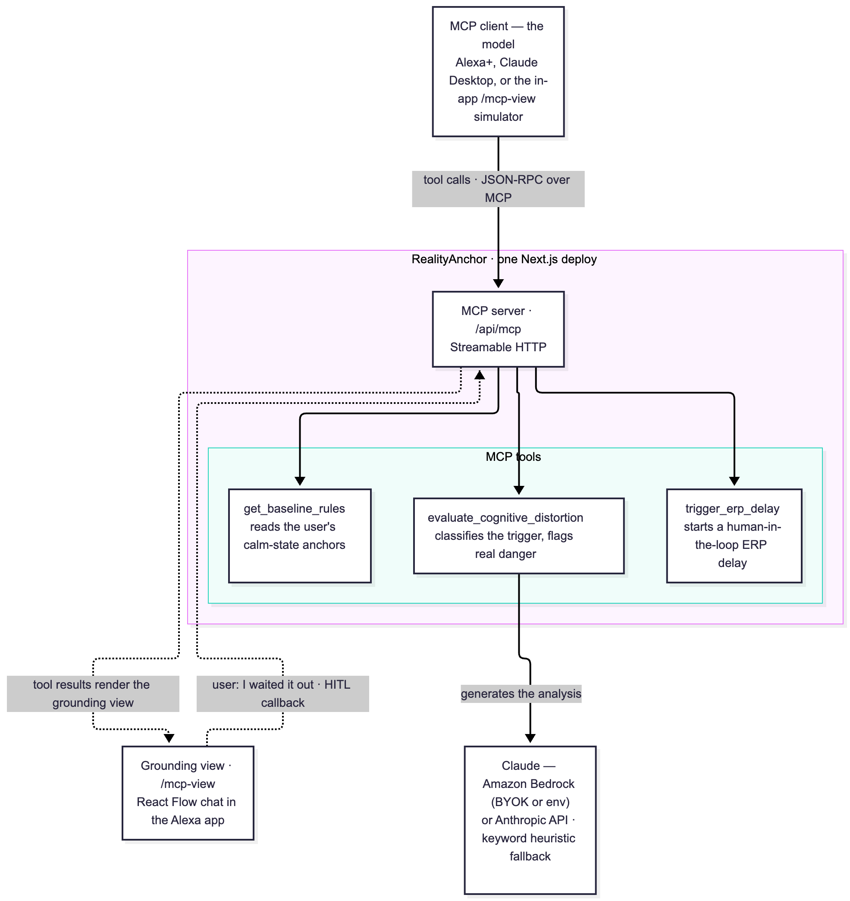

# RealityAnchor

**An Alexa+ MCP add-on for OCD and cognitive loops.** When an intrusive loop hits,
RealityAnchor grounds you in your own calm-state rules. It pauses the compulsion,
lets an anchor settle what it can, and tells you plainly when a danger is real.

▶ **[Watch the demo video](https://youtu.be/-ZBv4yTUJh4)**

---

## Quick start

Requires **Node.js 20+** and **pnpm**.

```bash
pnpm install
pnpm dev            # http://localhost:3000
```

- **App:** open http://localhost:3000/mcp-view and click a suggestion card.
- **MCP server:** http://localhost:3000/api/mcp (Streamable HTTP). Connect a
  client as shown in [MCP tools](#mcp-tools).

No keys are needed: without a model it runs on an offline heuristic. To use
Claude on Amazon Bedrock, see [Connect a real model](#connect-a-real-model-optional).

---

## MCP tools

The server lives at **`/api/mcp`** and uses the **Streamable HTTP** transport (MCP
spec 2025-11-25). It's stateless, so each request gets a fresh server and it runs
on any serverless host.

| Tool | Input | What it does |
| --- | --- | --- |
| `get_baseline_rules` | `userId` (string) | Returns the user's calm-state anchors, so the assistant grounds them in their own words instead of improvising reassurance. |
| `evaluate_cognitive_distortion` | `trigger_event` (string) | Classifies the trigger against CBT distortions, rates the risk, flags genuine safety signals, and returns a `resolution`: `hitl`, `auto`, or `genuine`. Uses the model when one is configured. |
| `trigger_erp_delay` | `delay_minutes` (number, 1–120) | Starts a human-in-the-loop ERP delay: the user agrees to wait before acting on the urge. |

Typical sequence: `evaluate_cognitive_distortion`, then, if the resolution is
`hitl`, `trigger_erp_delay`. `get_baseline_rules` can be called at any point to
read the anchors back.

### Connect an MCP client

Any MCP client can stand in for Alexa+. Point it at the endpoint with the
Streamable HTTP transport:

```bash
# Claude Code
claude mcp add --transport http reality-anchor http://localhost:3000/api/mcp
claude mcp list        # → reality-anchor … ✔ Connected
# then in a session, describe a worry, e.g. "I keep worrying I left the stove on"

# MCP Inspector (GUI, good for raw tool calls)
npx @modelcontextprotocol/inspector
# Transport: Streamable HTTP · URL: http://localhost:3000/api/mcp → Connect
```

**Claude Desktop**, through the `mcp-remote` bridge in
`claude_desktop_config.json`:

```json
{
  "mcpServers": {
    "reality-anchor": {
      "command": "npx",
      "args": ["-y", "mcp-remote", "http://localhost:3000/api/mcp"]
    }
  }
}
```

**Cursor** (`.cursor/mcp.json`):

```json
{ "mcpServers": { "reality-anchor": { "url": "http://localhost:3000/api/mcp" } } }
```

Setup for Gemini, VS Code, and other clients is in [docs/DEV.md](docs/DEV.md).
Every client needs the same two things: the Streamable HTTP transport and the
`/api/mcp` URL.

The grounding view can also be opened with the context Alexa+ would pass, for example:

```
http://localhost:3000/mcp-view?tool=trigger_erp_delay&minutes=3&trigger=touched_mail
```

---

## What it does

You talk to Alexa+ the way you already do. When a loop starts, Alexa+ calls
RealityAnchor's MCP tools, and the flow ends in one of three outcomes:

| Urge | Outcome | What happens |
| --- | --- | --- |
| Checking: *"I locked the door, but what if I didn't?"* | **Pause (human-in-the-loop)** | Names the trap (intolerance of uncertainty), reads back your anchor, then starts a timed ERP delay instead of reassuring you. You sit with the doubt and commit when ready. |
| Contamination: *"My hands feel dirty, but they look clean."* | **Auto-resolve** | One of your anchors already settles it, so the loop closes without a delay. |
| Real safety signal: *"I smell gas."* | **Act now** | Real evidence isn't the loop. It tells you to act right away and doesn't hold a delay. |

The ERP pause is based on Exposure and Response Prevention therapy. Reassurance
on demand is the compulsion, so the helpful move is to delay it.

A visual **grounding view** (`/mcp-view`) shows each MCP tool call as a live trace
and builds the flow as a diagram, the way Alexa+ could present it in the Alexa app.

> RealityAnchor is a prototype. It is not medical advice and doesn't replace
> treatment from a qualified clinician. In an emergency, contact your local
> emergency services.

---

## Using the app

1. Open `/mcp-view`.
2. Click a suggestion card (**Checking urge**, **Contamination**, or **A real
   safety signal**), or type your own worry.
3. Watch the **"Alexa+ called your MCP tools"** trace. These are real calls to the
   MCP server. The flow and the **Alexa+ says** reply build from the results.
4. At an ERP countdown, wait as long as you like, then click **Commit to Delay**.
5. To view or edit your calm-state rules, click **Anchors** in the nav bar before
   a chat starts, or use the **Anchors** tab beside the flow once it has. Click
   **New** to start over.

Open the **gear menu** to change the layout (unified chat or three panes) and the
model settings.

### Connect a real model (optional)

The app works with no setup. Without a model it runs on an offline keyword
heuristic, and the MCP tool calls are still real. To get real model output from
Claude, use either option below.

**Option A: bring your own key (no server setup).** In `/mcp-view`, open the gear
menu, paste an **Amazon Bedrock API key** (or an IAM access key and secret) and a
region, then click **Save key**. The key is stored only in your browser and is
sent with each request. The server never writes it anywhere. The nav pill
changes to **Bedrock connected**.

**Option B: server environment.** Copy the example file and set one provider:

```bash
cp .env.example .env.local
```

```bash
# Amazon Bedrock
AWS_ACCESS_KEY_ID=...
AWS_SECRET_ACCESS_KEY=...
AWS_REGION=us-west-2

# or the first-party Claude API
# ANTHROPIC_API_KEY=sk-ant-...

# Optional model override (Bedrock IDs need the "anthropic." prefix)
# REALITY_ANCHOR_MODEL=anthropic.claude-sonnet-4-6
```

Restart `pnpm dev` after changing env. The app picks a provider in this order:

1. Your own Bedrock key from the gear menu
2. `ANTHROPIC_API_KEY`
3. Bedrock credentials in env
4. No key: either the offline heuristic or an alert asking you to connect a key,
   set under **Settings → When no AI key is set**

Each analysis node shows an **AI** or **heuristic** badge, so you can tell which
path ran.

---

## Architecture

Everything runs in one Next.js deployment.



- **MCP client.** Alexa+, any external MCP client (Claude Code, Claude Desktop,
  Inspector), or the in-app simulator calls the tools over Streamable HTTP.
- **MCP server (`/api/mcp`).** Exposes the three tools. Built on the MCP SDK's
  `WebStandardStreamableHTTPServerTransport`, in stateless mode.
- **Model.** `evaluate_cognitive_distortion` asks Claude on **Amazon Bedrock**
  (or the Anthropic API) for a structured analysis, with a keyword heuristic as
  the fallback.
- **In-app Alexa+ simulator (`/api/agent`).** A real MCP client that connects back
  to `/api/mcp`. With a model, Claude decides which tools to call. Without one, a
  script calls them. Either way, every call is a real MCP round trip, streamed to
  the browser as server-sent events. A bring-your-own key is forwarded on this
  loopback call in a request header.
- **Grounding view (`/mcp-view`).** Chat transcript, MCP traces, and a React Flow
  diagram. The ERP **"I waited it out"** step calls `/api/resume-session`, the
  human-in-the-loop callback.

Diagram source: [docs/architecture.mmd](docs/architecture.mmd). The same image is
on the `/docs` page.

---

## Tech stack

- **Next.js 15** (App Router), **React 19**, **TypeScript**
- **MCP TypeScript SDK** (`@modelcontextprotocol/sdk`): Streamable HTTP server and loopback client
- **Amazon Bedrock** through `@anthropic-ai/bedrock-sdk`: Claude for analysis and the agent loop
- **Anthropic SDK** (`@anthropic-ai/sdk`): first-party Claude API fallback
- **React Flow** (`@xyflow/react`): grounding flow diagram
- **Zustand**: client state
- **Tailwind CSS**, **next-themes**, **react-resizable-panels**: UI
- **zod**: validation

---

## Hackathon

RealityAnchor was built for Amazon's **Build, Ship, Shape** hackathon, in the
**Alexa+ track**.

- **Alexa+ MCP add-on.** A self-hosted MCP server over Streamable HTTP (MCP spec
  2025-11-25) that any Alexa+-class agent can connect to. There is no public
  Alexa+ developer access for MCP add-ons yet, so the experience is simulated in a
  web app, as the track recommends, and tested with real MCP clients.
- **AWS Builder mini challenge.** Uses **Amazon Bedrock** (Claude) for the
  distortion analysis and the agent's tool-use loop, with bring-your-own-key
  support. See [`src/lib/mcp/model.ts`](src/lib/mcp/model.ts) and
  [docs/DEV.md](docs/DEV.md).
- **Open Source mini challenge.** A companion MIT-licensed template pulled out of
  this project:
  [nextjs-mcp-streamable-http](https://github.com/TLiu2014/nextjs-mcp-streamable-http),
  a stateless MCP server on the Next.js App Router with a loopback client.

Demo video: https://youtu.be/-ZBv4yTUJh4

---

## Docs

- [docs/DEV.md](docs/DEV.md): local development, testing, MCP client setup
- [docs/DEPLOYMENT.md](docs/DEPLOYMENT.md): deploying to a public URL
- `/docs` in the running app: overview, architecture, tools, flow, ERP, anchors

## License

[MIT](LICENSE)
